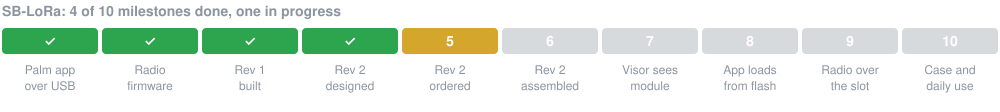
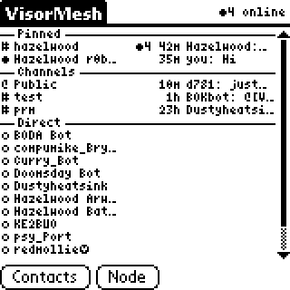
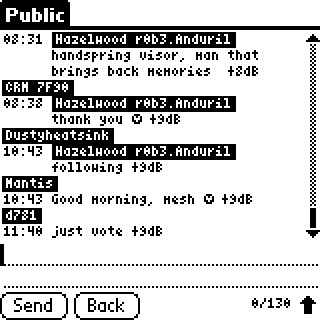
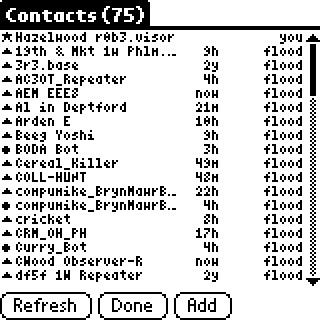
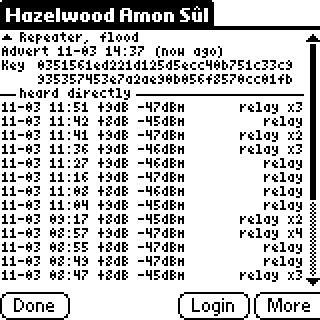
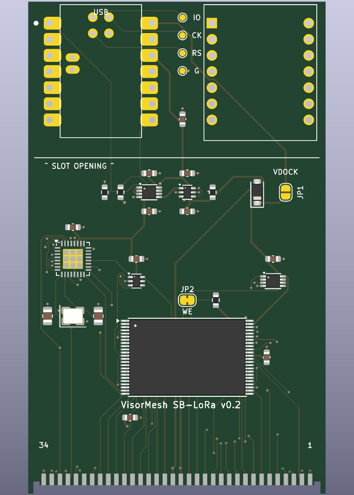
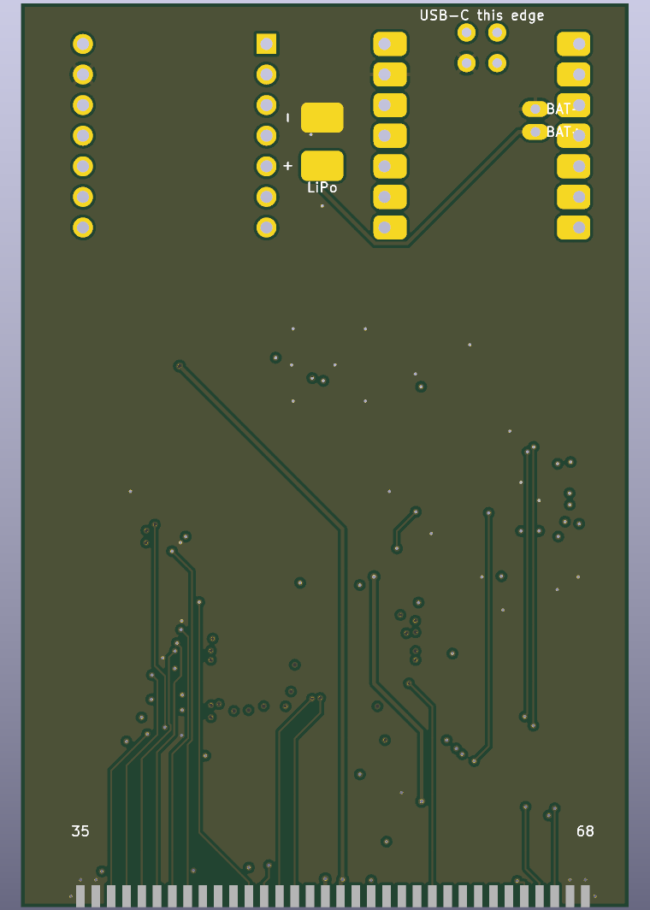
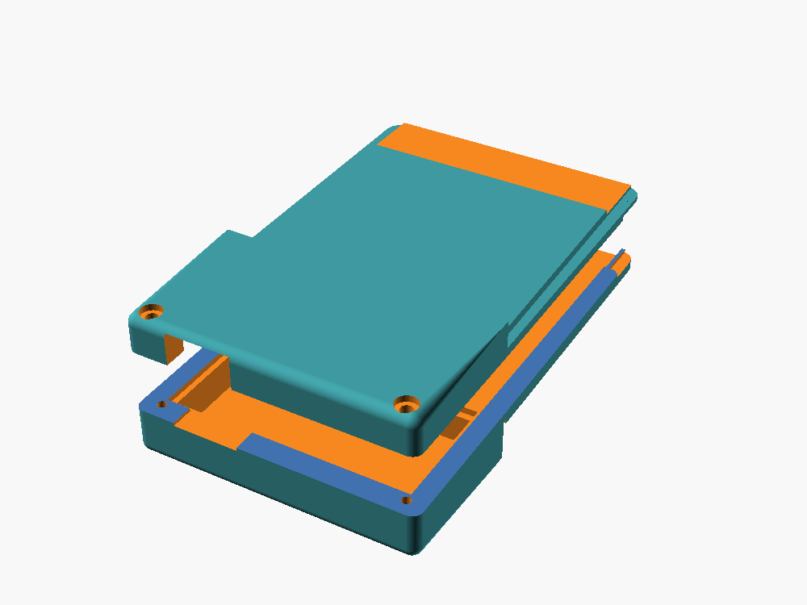

# VisorMesh

A MeshCore client for the Handspring Visor (Palm OS 3.5.2H3.0).

The Visor works as a terminal for a MeshCore **companion radio**. The radio (a Seeed XIAO nRF52840 with a Wio-SX1262) handles LoRa, routing and crypto. The Visor only speaks the companion framing protocol over a byte stream. The radio sits on a custom Springboard module with its own LiPo, so it keeps meshing while the Visor sleeps.

See [docs/design.md](docs/design.md) for the architecture and the reasons behind each decision, and [docs/progress.md](docs/progress.md) for the current status and log.

## Status

The Palm app works today over the Visor's USB cradle, through a bridge on a Mac to the radio's UART. The SB-LoRa module puts the radio in the Springboard slot instead. Its milestones:

1. **Palm app over USB:** conversations, channels, contacts, node settings and a map, running on a Visor Neo.
2. **Radio firmware:** MeshCore's companion firmware patched to also talk on the XIAO's D6/D7 UART.
3. **Rev 1 built:** boards made by JLCPCB (`hw-v0.1`). Its connector part went obsolete and the 1.6 mm board is too thick for the replacement, so it stays a test board.
4. **Rev 2 designed:** 4 layers, 0.8 mm, around the measured MCS-068SMA1 connector, with flash so the app loads when the module goes in. DRC clean.
5. **Rev 2 ordered** (in progress): fab files for JLCPCB and PCBWay, see [REV2.md](hardware/sb-lora/REV2.md#ordering-pcbway).
6. **Rev 2 assembled:** connector, XIAO, Wio and LiPo fitted by hand.
7. **Visor sees the module:** the slot reports the card and the flash ID reads back.
8. **App loads from the module's flash** on insertion.
9. **Radio over the slot:** a companion query round trip through the Springboard UART.
10. **Case and daily use:** the 3D-printed case fitted, and the module in everyday use.

The dated log is in [docs/progress.md](docs/progress.md).

## Screenshots

Taken on a Visor Neo (160 x 160, shown at 2x) on PhillyMesh.

| Home | Channel | Contacts | Repeater |
|---|---|---|---|
|  |  |  |  |

## SB-LoRa rev 2

| Top | Bottom | Case (draft) |
|---|---|---|
|  |  |  |

The XIAO and the Wio-SX1262 sit side by side at the outer end, outside the slot. In the slot: the S29AL008J flash (the module's app), the TL16C2550 UART and the level translators, with the connector straddling the board's inner edge. The LiPo is on the bottom, under the radios. Design notes are in [REV2.md](hardware/sb-lora/REV2.md).

## Repo layout

| Path | What |
|---|---|
| `hardware/sb-lora/` | SB-LoRa Springboard carrier board: KiCad, fab outputs (JLCPCB and PCBWay), generator scripts. See its [README](hardware/sb-lora/README.md) |
| `firmware/` | MeshCore companion firmware patch for the XIAO (UART on D6/D7 plus USB), build Makefile, bench query tool and a fake radio |
| `palm-client/` | VisorMesh, the Palm OS client: MeshTerm-style conversations, channels, contacts, node settings. Works over the Visor USB cradle via a Mac bridge until the SB-LoRa boards arrive. See its [README](palm-client/README.md) |
| `docs/design.md` | Architecture, protocol notes and decisions |
| `docs/progress.md` | Status, milestones and a dated log |
| `docs/upstream-issues.md` | Problems found in pilot-link, PilRC/prc-tools and MeshCore, with evidence and workarounds, ready to report |
| `docs/reference/` | Third-party reference: Handspring Springboard dev guide and mechanical spec, the Handspring SDK (`HsExt.h`, Springboard docs and tools), springSD v1.1 hardware |

## Versioning

Hardware revisions are tagged in git (`hw-v0.1`, `hw-v0.2`, ...), so the files that went to fab for each order stay recoverable. Each board's README records its revision and status.
