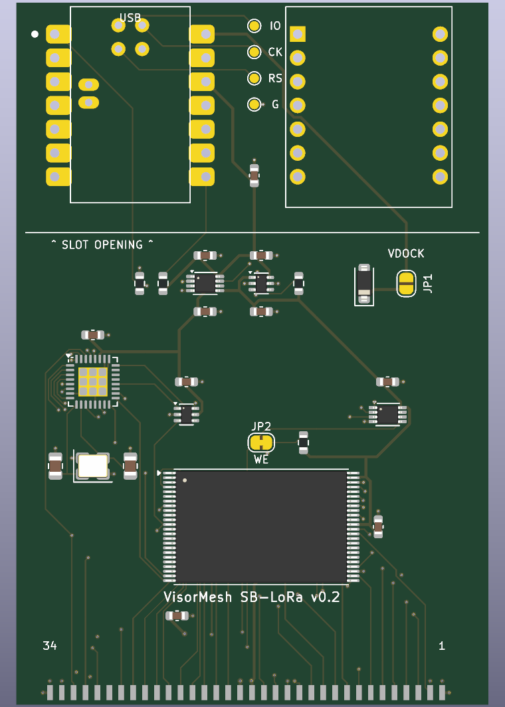
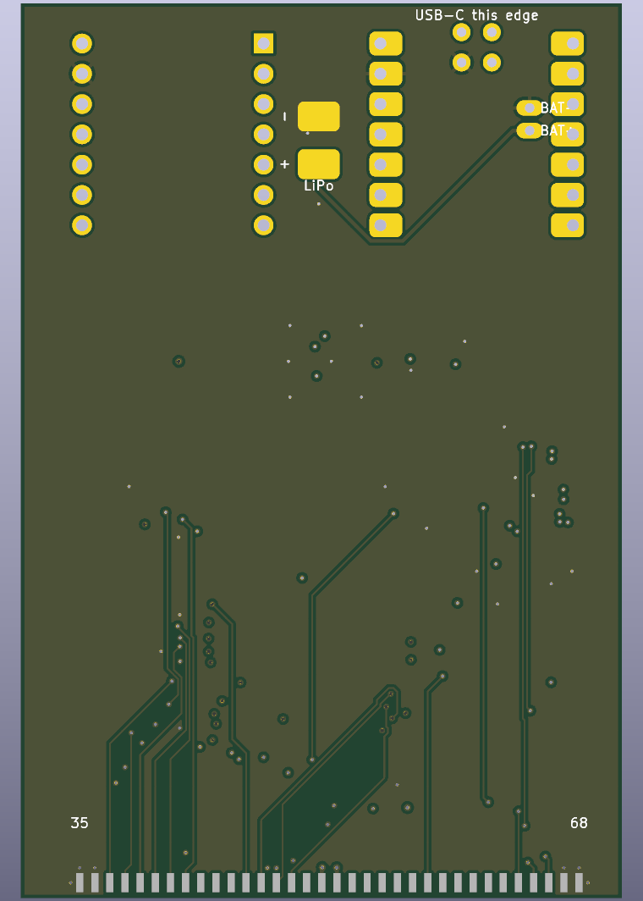

# SB-LoRa rev 2 plan

Laid out, not ordered: J1's land pattern is a placeholder until a connector is chosen. Rev 1 (`hw-v0.1`) is ordered and shipping, but its Hirose IC1HA straddle connector is obsolete and the order for one was cancelled (2026-11-17). Until rev 2 arrives, rev 1 is built with a harvested or wired-on connector (see "Without the Hirose part" in [README.md](README.md)). Rev 2 changes the connector, adds a flash chip so the app loads itself, and makes the module as flat as possible.

## Decided

### Radio: XIAO and Wio side by side, no stack

The XIAO nRF52840 and the Wio-SX1262 board keep their roles but sit flat on the carrier next to each other, instead of stacked on 2.54 mm headers. The stack is the tallest thing on rev 1. Side by side, the height is set by the XIAO's USB-C socket (about 3.2 mm) and the Wio's u.FL.

- Both are 14-pin boards the size of the XIAO. In the kit the XIAO has a male pin header that plugs into the Wio, so they separate by unplugging. The rev 1 extension is 50.4 mm wide and 24.6 mm deep, which holds two of them (about 18 x 21 mm each) with the XIAO's USB-C at the outer edge.
- The XIAO is soldered by its castellated edge pads, after its pin header is removed (or, keeping the header, through carrier holes with the plastic spacer slid off and the pins cut flush underneath). Flat on the carrier, its bottom pads are covered, so the carrier brings them out:
  - **BAT+ / BAT-** to pads for a flat pouch LiPo (the XIAO's charger still does the charging over USB-C).
  - **SWDIO / SWCLK / RST** to test pads, so the radio can be reflashed with a probe if the bootloader is lost.
  - The edge pins have no battery connection (5V is the USB input to the charger; feeding the LiPo there would put USB's 5 V on it), so BAT+/BAT- must come from the bottom pads. Under each bottom pad the carrier has a large plated hole, filled with solder from the back so it wicks up to the XIAO's pad. That joins them with no gap under the XIAO. The hole positions come from Seeed's XIAO nRF52840 v1.3 board file: BAT+/BAT- are 1.9 mm apart near the middle, the SWD pads a 2.54 mm square of four (SWDIO, SWCLK, RST, GND) toward the USB end. The fallback is a cut-out in the carrier under the pads, so wires can be soldered on from below.
- The Wio's D0 has a button to ground and a pull-up on the Wio, so its D0 pin stays unconnected (D0 is Visor-present on the XIAO).
- The Wio has a female socket on top (where the XIAO plugs in) and male pins underneath. On rev 2 its male pins go through plated holes in the carrier, with the plastic spacer slid off so the board sits flush (its underside is bare), and are cut flush underneath. Its top socket is about 8 mm tall, against about 3.2 mm for the XIAO's USB-C, and nothing plugs into it once the XIAO sits alongside, so it comes off. The easiest way is to cut the plastic body away with flush cutters, then pull each pin out with the iron and clear the holes with braid.
- The carrier wires the radio nets pin to pin, from the MeshCore `xiao_nrf52` variant:

  | XIAO pin | Net | Goes to |
  |---|---|---|
  | D1 | LORA_DIO1 | Wio |
  | D2 | LORA_RESET | Wio |
  | D3 | LORA_BUSY | Wio |
  | D4 | LORA_NSS | Wio |
  | D5 | SX126X_RXEN | Wio |
  | D8 / D9 / D10 | SCK / MISO / MOSI | Wio |
  | D6 / D7 | UART TX / RX | Visor bridge (as rev 1), not the Wio |
  | 3V3, GND | power | Wio and the XIAO-side level translators |
  | D0 | VISOR_PRESENT | slot power sensed through a translator, as rev 1 |

- The antenna is the Wio's existing flexible stick-on antenna on its u.FL. It goes inside the module case.

### Memory chip so the app loads itself

A 16-bit-wide 3.3 V NOR flash at the start of csSlot0 (CS0*), as the Springboard Development Guide requires for the module to be recognised (§2.1). With a Palm-MakeROM header and the app on it, the Visor mounts the module on insertion and switches to the app (§3.3; on Palm OS 3.5 and later the Welcome app is chosen by a ROM token, so the database can stay "VisorMesh").

- Part: Infineon S29AL016J70TFI020 (2 MB, x16, 70 ns, TSOP-48, 1.2 mm, bottom boot). Its IDs (01h, 2249h) and sector layout (16-8-8-32 KB, then 64 KB) are the same as the Am29LV160BB's, so Handspring's Flash Manager drives it unchanged. The pin table in `rev2/netlist.py` is checked against the datasheet. Room for the app and the Map basemap.
- WE* is wired so the app can rewrite the flash itself: HotSync a new .prc to RAM, then update the module from the app.
- A write-protect jumper: JP2 in the WE# line, bridged by default, cut to protect.
- Software: only the app's own code and resources are read-only when it runs from the module. Checked: all of its data (channels, contacts, messages, beam inbox, screenshots, map) is in RAM databases on card 0, and it never writes to its own database, so nothing changes. To keep the Map basemap in flash too, `map_form.c` must also look on card 1. The alarms (`bgcheck.c`, `sb_spi.c`) point at the app's database, and they go away with the module, which is fine because the radio does too.
- Getting the app onto the flash, all from the Visor, with no chip programmer:
  1. `make rom` on the Mac builds a module image with VisorMesh in it, following Handspring's MakeROM (its source is in `Handspring_SDK.zip`: `Handspring Tools/MakeROM/Src`).
  2. The image is wrapped in an updater .prc, as Handspring's Card Updater stationery does, and installed with HotSync like any app.
  3. The updater runs from RAM, erases and writes the flash, checks it, and asks for the module to be pulled and reinserted.
  - A blank or bad image has no valid header, so the module looks like rev 1 (hardware present, nothing mounted) and the updater can still write it. The first programming works the same way.
  - Handspring's Flash Manager source (same zip, `FlashManager Resources`) has drivers for AMD-style (29LV160 family) and SST 4 KB-sector parts. Pick a chip it supports, or add its ID to the table. Infineon S29AL016J is the in-production 29LV160 equivalent.
  - To check: what the launcher does when VisorMesh is in both RAM and the module during development.
- **Decided: the flash holds a small installer, and VisorMesh runs from RAM.** The Dev Guide (§1.5) says a module whose code installs interrupt handlers needs a Setup app, or the Visor soft-resets when the module is pulled, because the handler's code goes with it. VisorMesh's SB-LoRa transport installs one. So the flash's Welcome app copies VisorMesh into RAM when it's missing or older, and launches it; the app then runs exactly as it does now. This also settles the RAM-and-module question above.

This takes CS0*, so the radio link moves to csSlot1 (CS1*). The flash needs about 20 address lines and all 16 data lines, so rev 2 is expected to be a 4-layer board.

### Radio link: a bus UART on CS1*

A 16550-style UART on csSlot1 replaces rev 1's SC16IS740 SPI bridge and its latch logic (U1-U3). The flash already needs the full address and data bus, so the UART costs little routing, and each register access is one bus cycle instead of several per SPI bit.

- Part: NXP SC16C650BIBS (32-byte FIFOs, HVQFN32, LCSC C729132). The SC16C750BIBS (64-byte) has the same HVQFN32 pinout and fits the footprint; the SC16C550B doesn't. At 115200 baud a 32-byte FIFO fills in 2.8 ms.
- Wiring:
  - Strobes: the slot may assert OE*/WE* at the same moment as CS1* (Dev Guide table 6-2), but the UART wants IOR/IOW 10 ns after its CS. So the UART's CS is tied active and a SN74LVC2G32 makes IOR = OE* OR CS1* and IOW = WE* OR CS1*. Nothing else on the bus is affected: the UART only drives the data bus while IOR is low.
  - Register select A0-A2 of the UART from A1-A3 of the slot, so the registers sit at word addresses.
  - UART D0-D7 on slot D0-D7. The driver uses 16-bit reads and writes and keeps the low byte (a 68k byte access at an even address uses D8-D15).
  - The UART's INT and RESET are active high and the slot's IRQ* and RESET* are active low, so an SN74LVC2G04 inverts both.
- Clock: keep rev 1's 14.7456 MHz crystal (divisor 8 for 115200).
- Wait states: csSlot0 and csSlot1 share one setting, so it's set for the slower of the flash and the UART.
- Powered from the slot (VSB), with the level translators to the XIAO's always-on side as on rev 1.
- Software: `transport_sb.c` is rewritten for the UART, and its simulation test with it. The interrupt handler keeps the rules in AGENTS.md (segment 1, no globals).

## Open

- **Connector: the Hirose IC1HA order was cancelled (2026-11-17).** Candidate: 3M MCS-068SMA1-TR30, a 68-contact female PCMCIA receptacle for memory cards ("MEMPAK"), straddle mount, sold on eBay as surplus. It's a Robinson Nugent part (later 3M). The only document found is a catalogue overview page (Robinson Nugent PC Card Products p. 330, "MEMPAK Receptacles"), which gives "PCMCIA Spec, .050\" straddle mount, SMT solder tails, Standard mounting ears" with no offset on the tails; its drawing is on catalogue p. 333, which hasn't turned up. So each row is 34 tails at 1.27 mm, and the listing photos show the two rows directly above each other, with no stagger. The gap between the rows (the board thickness) isn't given, so it and the rest of the land pattern have to be measured from a sample. The same page lists MCS-068SSA1-TR30: one row of 68 SMT tails at .025\" (0.635 mm) on one side of the board, top or bottom mounting. That would suit a single-sided board of any thickness, but no stock turned up (only a broker listing for MCS-068SSA1-TR30TP with no quantity). The MCS-068SMA1 parts from eBay were ordered on 2026-11-19, and J1 is designed around them. Buy enough for every board in one order. Ruled out: a generic AliExpress 68-pin female part (single-sided, but $39 shipping and over 2 weeks, and its photos show an AMP-marked part while it's sold as "Jiansu BST"), TE 5535657 (the host-side header), Hirose IC1K-68RD-1.27SF(71) (LCSC lists it as "Connector and Ejector", which reads as the host-side socket), Hirose IC1F-68RD-1.27SF and IC9 (obsolete), Amphenol 10014744-007T and 71299-050CALF (out of production), and Amphenol 7111S1615A01LF (a SIM card tray). The Springboard uses the same 68-pin PCMCIA contacts (Dev Guide §5, §7.1), and the keying is in the module's plastic case, not the connector. Needed from a sample: markings, the gap between the two rows (the board thickness it takes), tail pitch, tail distance from the mating face, tail width and length, and the body size and any pegs.
- **Case.** The keying is in the module case, so rev 2 needs a case (printed, or a harvested Springboard shell) whose key and latch match the slot, with the board held at the connector's height. Dry-fit a bare harvested connector in the slot to check the contacts seat fully.
- **Board thickness.** A straddle connector sets it: the board is whatever fits between the two rows. The Hirose IC1HA took 1.6 mm, but PC Card internal boards are often about 0.8 mm, so measure the 3M part's gap before assuming 1.6 mm.
- **LiPo size.** The aim is at least a few days per charge. Estimate, to be replaced by a measurement:
  - The XIAO and SX1262 listen all the time (MeshCore companion doesn't sleep the radio): roughly 5-6 mA for the SX1262 in receive with boosted gain, plus 1-3 mA for the nRF52840 with the UART open. Transmits at 22 dBm draw about 120 mA but are short at SF10/BW500 and rare for a companion. Call it 7-10 mA on average.
  - 3 days at 10 mA is 720 mAh; with margin for usable capacity and ageing, about 1000 mAh. 500 mAh gives about 2 days.
  - Flat pouches of that size: about 5 x 30 x 50 mm for 1000 mAh, 4 x 25 x 50 mm for 500-600 mAh. The extension is 50.4 x 24.6 mm, so a 50 mm cell fits across it, under or beside the boards.
  - To measure: current into BAT+ with a meter in series, USB unplugged, over a few minutes of idle listening and one message sent.

## Netlist and layout

`rev2/netlist.py` has the parts and connections, in the same shape as rev 1's `source/netlist.py` (rev 1 stays as built under `hw-v0.1`). The board is laid out and routed with J1 as a straddle. **Don't order it until J1's pattern is measured** (below).

- **Board:** 50.43 x 75.05 mm, the same outline as rev 1. 4 layers, 1.6 mm: In1.Cu is a solid GND plane, F.Cu, In2.Cu and B.Cu carry signals, with GND pours on In2 and B. Every part is on the top except the LiPo pads (BT1), which are on the bottom under the radio boards, and J1's pins 35-68, which are on the bottom edge opposite pins 1-34. Tracks are 0.15 mm with 0.15 mm gaps, and vias are 0.5/0.25 mm, all within JLCPCB's standard 4-layer rules.
- **Build:** `rev2/make.sh` runs the whole pipeline: `set_project.py`, then `build_board.py` (placement and GND vias), then Freerouting 1.9.0, then `finish_board.py` (pours), DRC and `verify.py`. It needs KiCad 10 (the Homebrew cask), Java 21 (`openjdk@21`) and `FREEROUTING=/path/to/freerouting-1.9.0.jar`; Freerouting 2.x ignores the pass limit and never finishes. `rev2/make_fab.py fab` writes the JLCPCB gerbers zip, BOM, CPL and the hand-fit list.
- **Checks:** DRC reports 0 unconnected pads and no clearance errors. What's left is the XIAO footprint's outline silk being clipped at its pads, and warnings about the missing footprint-library table. `verify.py` checks every pad's net against the netlist, J1 against Table 5-1, J1's straddle (pins 1-34 on F.Cu, 35-68 on B.Cu, each directly opposite its partner), the flash's word mode, the UART strobes and register select, the inverters, and that only U5 and U6 cross the two power domains.
- **Renders:** `rev2/renders/`, below, made with `kicad-cli pcb render --side top|bottom -w 784 -h 1096 --background opaque`. J1's pads are the estimated straddle pattern.

| Top | Bottom |
|---|---|
|  |  |

Before ordering:
1. **J1.** The straddle pattern is in `build_board.py`: pins 1-34 on F.Cu and 35-68 on B.Cu directly opposite, at 1.27 mm (the same split as rev 1). The rest is estimated: 0.6 x 1.6 mm pads centred 1.3 mm from the edge. When the MCS-068SMA1 parts arrive (ordered 2026-11-19), measure one with calipers and set `J1_ROW`, `J1_PAD` and `BOARD_T` from it. Keep the 5.5 mm strip along the edge free (`J1_KEEP`) on both sides, and check whether the connector body needs the board edge moved. Then run `make.sh` and `make_fab.py` again, and regenerate the renders.
2. **XIAO and Wio footprints.** Check them against the real boards with calipers (print the top copper at 1:1).
3. **Assembly.** In JLC's placement preview, check the rotation of U1 (pin 1 at the top left, beside the triangle), U2, U3, U5 and Y1.
4. **Board thickness.** Match it to the 3M part's gap between the rows. If that's thinner than 1.6 mm, change `BOARD_T` in `build_board.py` and the thickness in the JLC order to suit.
5. Tag the commit you order from as `hw-v0.2`.

## Carried over from rev 1

- VDOCK charging option (D1, JP1).
- Level translators between the Visor's slot power and the XIAO's always-on 3V3, so neither side back-powers the other. Merge the three SN74LVC1T45 into a 74LVC2T45 plus one.
- Add test pads on the bus signals and the UART.

## What rev 1 can still tell us

Even without a connector, a bare rev 1 board can be dry-fitted in the slot to check the outline and the assumption that the top of the 50.47 mm section lines up with the slot opening. If the Hirose part does arrive, rev 1 also proves the slot bus timing and the interrupt path, though its SC16IS740 driver doesn't carry over.
