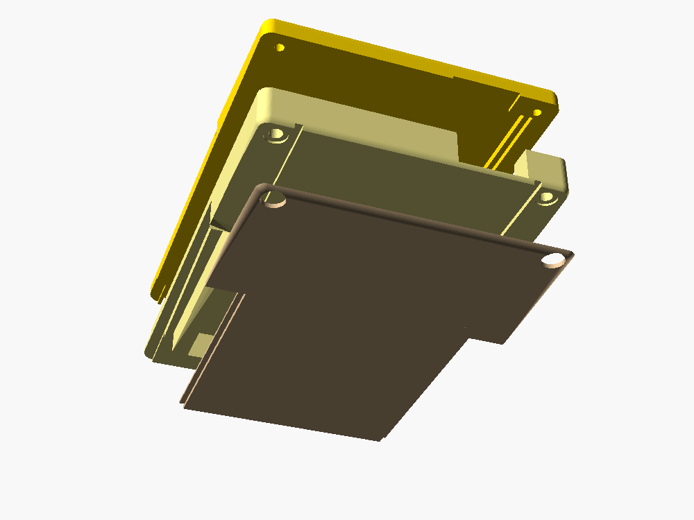

# SB-LoRa rev 2 case

A three-part 3D-printed Springboard module shell for the rev 2 board, for FDM printing (PLA or PETG, 0.4 mm nozzle). **Draft:** it hasn't been printed, and the values marked MEASURE in `sb_lora_case.scad` are guesses.



## Parts

- `sb_lora_case.scad`: the parametric model (OpenSCAD).
- `sb-lora-case-base.stl`: holds the board.
- `sb-lora-case-lid.stl`: covers the parts and the radio boards, with a pocket for a flexible antenna, and has the LiPo tray on the back.
- `sb-lora-case-cover.stl`: the battery cover, which also forms the bump's outer face.

Rebuild the STLs after changing a parameter:

```sh
openscad -D 'part="base"' -o sb-lora-case-base.stl sb_lora_case.scad
openscad -D 'part="lid"' -o sb-lora-case-lid.stl sb_lora_case.scad
openscad -D 'part="cover"' -o sb-lora-case-cover.stl sb_lora_case.scad
```

## Shape

- **In the slot:** the outside follows Handspring's *Springboard Standard Module Inspection Document* 80-0075-00 Rev B (`docs/reference/handspring_80-0075-00_RevB_standard_module_inspection.pdf`), which agrees with a Memplug module. It is 56.83 mm long, 53.83 mm wide at the connector end and 54.60 mm at the outer end, and 5.96 mm thick. For its last 12.1 mm the connector end is 4.98 mm thick, recessed 0.98 mm on the label face. There it has R2.75 corners and a keying slot in each side: 2.18 deep, 1.51 high, 7.75 long, 1.54 below the recessed label face, with a 1 mm lead-in. The label face narrows (49.35 to 51.51 mm) for the slot's lips. J1's face is flush with the end, with its contacts 2.80 mm below the recessed label face (3.78 mm below the Visor's back), on the board's mid-plane.
- **The bump:** past the slot opening, a box, flat against the Visor and rounded beyond, holds the XIAO and the Wio above the board. Past the module's inner face it stands only 1.8 mm, for the pin stubs under the board.
- **The LiPo:** a flat cell (`cell`, placeholder 4.5 x 40 x 42 mm, about 700-750 mAh) lies on the back of the in-slot part, in a tray sunk into the lid as far as the parts under it allow (0.8 mm floor over them). It runs from just past the recessed connector end, which goes under the Visor's housing, to the radio boards. The tray is 47 mm wide, inside the slot's lips. Its leads go through the tray's end wall into the radio space, then down past the board's edge to the BT1 pads underneath.
- **Size:** the back is flat from the tray to the bump's end and stands 4.5 mm proud of the Visor's back. Assembled, the case is 54.6 x 86.2 x 12.3 mm at the bump and 10.4 mm over the slot.
- **Split:** the case splits at the board's top face, and the battery cover is a third part. The base and lid print flat on the split face and the cover on its outer face, with no supports. The lid bears on the board's long edges. The cover slides in from the bump's far end, its two rails running in grooves along the tray's walls, and two M2 x 10 self-tapping screws at the far corners hold all three parts together. The XIAO's USB-C is reached through the far end.
- **Antenna:** a pocket for a 42 x 10 mm 915 MHz FPC antenna on the lid's ceiling, over the radio boards, fed from the Wio's u.FL.

## Before printing the real case

1. **Check against a Memplug** the parts the drawing leaves open: how deep the narrower label face is (`lip_h`, 1.6 mm from nkorth's cover), and the outer-end latch features: which face the 3.58 mm grooves 4.70 mm from each side and the 0.90 mm corner recesses are on, and how deep and long they are (`latch_*`, now 1.0 mm deep into the inner face).
2. **Thin walls:** at the connector end the wall under J1 is about 0.7 mm, and between J1 and each keying slot about 0.7 mm. Print a test of the first 15 mm to check they come out and that J1 fits.
3. **Measure the radio boards and the LiPo:** the height of the XIAO with its USB-C and of the Wio with its u.FL plug above the carrier (`radio_h`), the pin stubs below it (`under_h`), and the cell bought (`cell`). A cell up to about 41 mm wide and 42 mm long fits; its thickness sets how far the back stands out.
4. **Rails:** print the cover and lid and check the cover slides in. The rails are 1.0 x 0.5 mm with 0.15 mm clearance.
5. **Check the Visor's top end:** the bump sits against it, so make sure it clears the IR window and the stylus.

## Print settings

0.2 mm layers, 4 perimeters (the bump walls are 1.6 mm), 20% infill. The base and lid print split face down, the cover outer face down.
